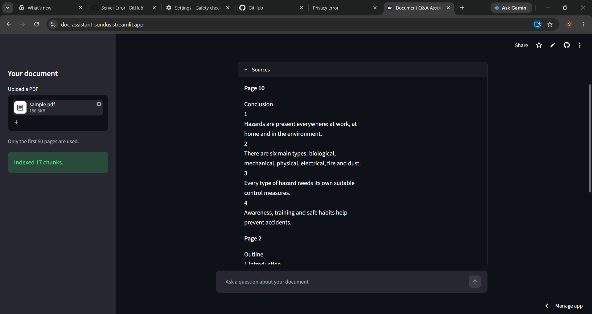

# Document Q&A Assistant

Upload a PDF, ask questions in plain English, and get answers with page citations.

**Live demo:** https://doc-assistant-sundus.streamlit.app



## What it does

- Upload any text-based PDF (the first 50 pages are used)
- Ask questions in a chat box
- Get answers based only on the document, with page numbers
- See the exact source passages behind every answer
- Says so when the answer is not in the document

## How it works (RAG pipeline)

1. **Extract:** read the text from each PDF page with pypdf
2. **Chunk:** split the text into 500-character pieces with 100 characters of overlap
3. **Embed:** convert each chunk into a vector with the all-MiniLM-L6-v2 sentence-transformers model
4. **Store:** save the vectors in a ChromaDB collection
5. **Retrieve:** embed the question and find the 4 most similar chunks
6. **Generate:** send the chunks and the question to Gemini, with instructions to answer only from the context and cite page numbers

## Tech stack

Python, Streamlit, ChromaDB, sentence-transformers, pypdf, Google Gemini API

## Reliability

If the AI service is busy or rate limited, the app retries and falls back to another Gemini model instead of crashing.

## Run it locally

1. Clone the repository and open the folder
2. Create and activate a virtual environment:
```
   python -m venv .venv
   .venv\Scripts\activate
```
3. Install the libraries:
```
   pip install -r requirements.txt
```
4. Create a file named `.env` with your Gemini API key:
```
   GEMINI_API_KEY=your-key-here
```
5. Start the app:
```
   streamlit run app.py
```

## Limitations

- Scanned PDFs (images of pages) are not supported, because there is no OCR step yet
- Only the first 50 pages are indexed
- The free Gemini tier has daily usage limits

## Ideas for next versions

- OCR for scanned documents
- Support for multiple documents at once
- Evaluation with a set of test questions
- A custom HTML/CSS front end

## Author

Built by Sundus.